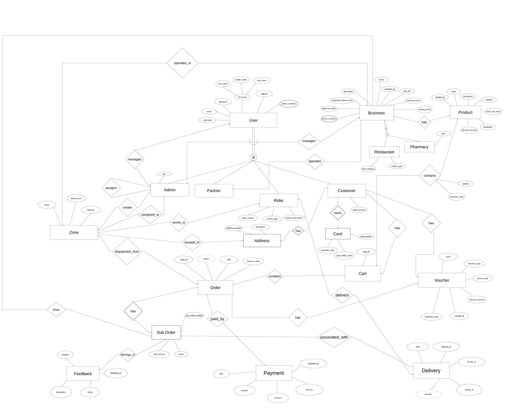

# MAGYM Logistics

A database design project for a local delivery and fulfillment platform connecting customers, restaurants, pharmacies, and riders.

**Ongoing team project · September 2026–present**  
CSEN 501 · Databases I · German University in Cairo · Winter 2026

[Explore the project walkthrough](https://doma990.github.io/projects/magym-logistics/) · [Browse the relational schema](https://doma990.github.io/projects/magym-logistics/#schema)

## Project progress

The project is developed collaboratively across **three distinct milestones** and is still under development. This repository currently contains the Milestone 1 design artifacts.

| Milestone | Work | Repository status |
| --- | --- | --- |
| 1 | Enhanced Entity–Relationship Diagram (EERD) and relational schema | Available |
| 2 | Further course project development | To be documented |
| 3 | Final course project milestone | To be documented |

## The system

Customers build carts from products offered by local businesses. At checkout, an order can split into business-specific suborders. Riders handle delivery, payments belong to the main order, and feedback is associated with individual suborders. Zones organize geographic coverage and delivery fees; vouchers support customer discounts.

The model brings together four user roles—Admin, Partner, Rider, and Customer—and two business types: Restaurant and Pharmacy.

## Milestone 1 · Design

The conceptual model captures entities, specializations, relationships, and constraints. Its relational mapping contains **25 relations**, with primary keys, foreign keys, and composite identifiers.

- **Specialization:** shared account and business attributes stay in parent relations, with distinct subtype relations.
- **Multiple phone numbers:** separate user and business phone relations preserve multivalued contact information.
- **Cart contents:** a junction relation stores the selected product, quantity, and customer notes.
- **Suborder identity:** `(sub_order_number, order_id)` identifies a suborder and is referenced by delivery and feedback records.

### Design files

- [Complete EERD · PDF](milestones/ms1/eerd.pdf)
- [Relational schema · PDF](milestones/ms1/relational-schema.pdf)
- [Editable EERD · draw.io](milestones/ms1/magym-logistics.drawio)

For a zoomable diagram and a searchable schema with linked references, use the [portfolio walkthrough](https://doma990.github.io/projects/magym-logistics/).

### Open the editable diagram

Download the `.drawio` file and open it in [diagrams.net](https://app.diagrams.net/) using **File → Open from → Device**. The PDFs can be read directly or downloaded from GitHub.

## Collaboration

Developed as a team course project for CSEN 501 Databases I. The artifacts preserve the team's Milestone 1 design; this repository will grow as later milestones are completed.
